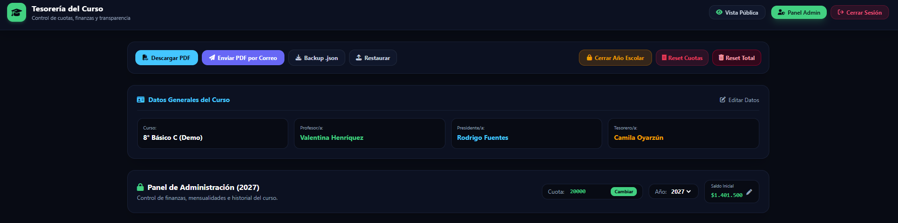
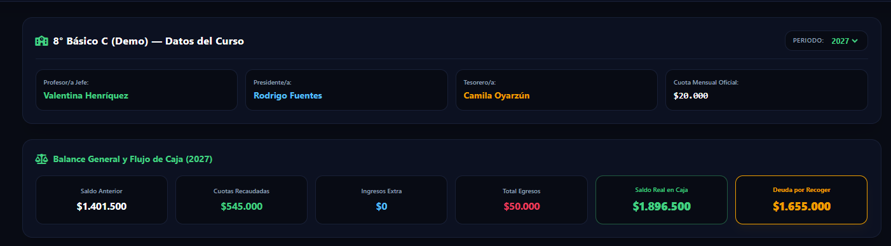
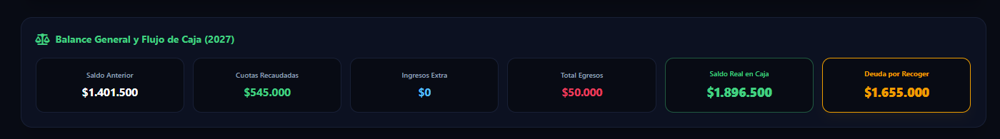
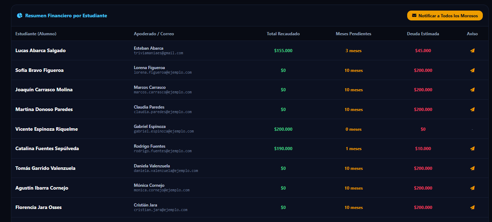
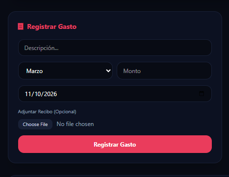
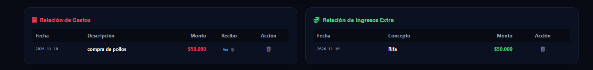
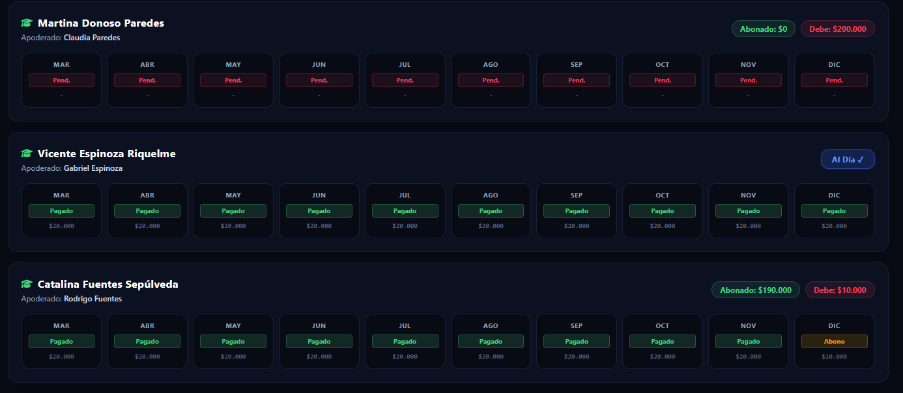
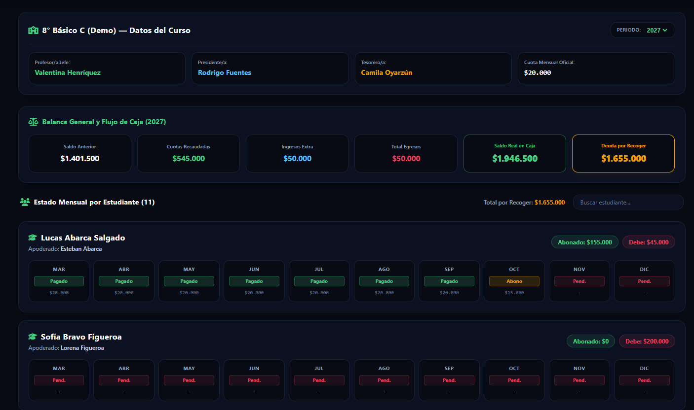

# 📊 Tesorería del Curso — Plataforma Web de Gestión Financiera y Transparencia Escolar

Plataforma web integral diseñada para la administración y rendición de cuentas financieras de cursos escolares (actualmente configurada para **8° Básico B**). El sistema permite controlar mensualidades, emitir balances en formato PDF, gestionar gastos con respaldo documental digital, registrar ingresos extraordinarios, notificar estados de pago por correo electrónico y automatizar el traspaso anual de fondos.

---

## 📑 Tabla de Contenidos

1. [Visión General y Propósito](#-visión-general-y-propósito)
2. [Arquitectura Tecnológica](#-arquitectura-tecnológica)
3. [Estructura del Proyecto y Directorios](#-estructura-del-proyecto-y-directorios)
4. [Módulos y Secciones Detalladas](#-módulos-y-secciones-detalladas)
   - [4.1 Cabecera y Barra de Acciones Globales](#41-cabecera-y-barra-de-acciones-globales)
   - [4.2 Ficha de Datos Generales del Curso](#42-ficha-de-datos-generales-del-curso)
   - [4.3 Panel de Administración y Configuración Rápida](#43-panel-de-administración-y-configuración-rápida)
   - [4.4 Balance General y Flujo de Caja (KPIs)](#44-balance-general-y-flujo-de-caja-kpis)
   - [4.5 Resumen Financiero por Estudiante y Notificaciones](#45-resumen-financiero-por-estudiante-y-notificaciones)
   - [4.6 Formularios de Operación en Línea](#46-formularios-de-operación-en-línea)
   - [4.7 Tablas de Relación de Gastos e Ingresos Extra](#47-tablas-de-relación-de-gastos-e-ingresos-extra)
   - [4.8 Gestión de Pagos Mensuales por Estudiante](#48-gestión-de-pagos-mensuales-por-estudiante)
   - [4.9 Generación y Distribución de Informes PDF](#49-generación-y-distribución-de-informes-pdf)
   - [4.10 Vista Pública de Consulta para Apoderados](#410-vista-pública-de-consulta-para-apoderados)
5. [Guía de Descarga, Instalación y Puesta en Marcha](#-guía-de-descarga-instalación-y-puesta-en-marcha)
6. [Configuración de Variables de Entorno (.env)](#-configuración-de-variables-de-entorno-env)
7. [Despliegue en Producción (Render)](#-despliegue-en-producción-render)
8. [Estrategia de Persistencia y Respaldo de Datos](#-estrategia-de-persistencia-y-respaldo-de-datos)

---

## 🎯 Visión General y Propósito

El sistema resuelve la complejidad operativa y la falta de transparencia que usualmente enfrentan las directivas y comités de tesorería escolar. Entrega a los apoderados una visión en tiempo real del saldo disponible y a los administradores una herramienta para:
- Evitar discrepancias contables entre abonos y gastos.
- Despachar estados de cuenta oficiales con enlaces directos a comprobantes y reportes.
- Ordenar automáticamente las nóminas según el apellido paterno del alumno, manteniendo coherencia con las listas del colegio.

---

## 🛠 Arquitectura Tecnológica

- **Frontend:** React 18, Vite, Tailwind CSS, FontAwesome Icons, JSPDF y JSPDF-AutoTable.
- **Backend:** Node.js, Express (ES Modules), Multer (manejo multipart/form-data), CORS, Dotenv.
- **Base de Datos:** Almacenamiento semi-estructurado en sistema de archivos JSON (`curso_datos.json`).
- **Servicios Externos:** API REST de EmailJS para despacho transaccional masivo de correos con plantillas dinámicas.

```
                      ┌───────────────────────────────────────────────┐
                      │          Navegador Web del Usuario            │
                      │   (Vista Pública o Panel de Administración)   │
                      └──────────────────────┬────────────────────────┘
                                             │ HTTP REST
                                             ▼
                      ┌───────────────────────────────────────────────┐
                      │         Servidor Express (Node.js)            │
                      └───────┬──────────────┬──────────────┬─────────┘
                              │              │              │
                     Lectura/ │      Archivos│      Despacho│
                    Escritura │      Estáticos│       Correos│
                              ▼              ▼              ▼
                     ┌────────────────┐┌───────────┐┌────────────────┐
                     │curso_datos.json││ /uploads/ ││  EmailJS API   │
                     └────────────────┘└───────────┘└────────────────┘
```

---

## 📁 Estructura del Proyecto y Directorios

```text
app_apoderados_gastos/
├── docs/
│   └── images/                       <-- Carpeta reservada para tus capturas de pantalla
│       ├── 01_admin_cabecera.png
│       ├── 02_datos_curso.png
│       ├── 03_balance_kpi.png
│       ├── 04_resumen_estudiante.png
│       ├── 05_formularios_registro.png
│       ├── 06_relacion_gastos_ingresos.png
│       ├── 07_gestion_pagos_cards.png
│       └── 08_vista_publica.png
├── backend/
│   ├── config/
│   │   └── db.js                     # Gestor de persistencia del archivo JSON
│   ├── data/
│   │   └── curso_datos.json          # Archivo de base de datos
│   ├── routes/
│   │   └── apiRoutes.js              # Definición de endpoints REST y lógica de negocio
│   ├── uploads/                      # Almacén físico de comprobantes y balances PDF
│   ├── .env                          # Variables de entorno y credenciales
│   ├── app.js                        # Inicialización del servidor Express y rutas públicas
│   └── package.json
├── frontend/
│   ├── src/
│   │   ├── components/
│   │   │   ├── VistaAdmin.jsx        # Módulo administrativo completo
│   │   │   └── VistaPublica.jsx      # Módulo de consulta ciudadana para apoderados
│   │   ├── services/
│   │   │   └── cursoApi.js           # Capa de consumo de API (fetch)
│   │   ├── App.jsx                   # Componente raíz y control de sesión
│   │   ├── index.css                 # Configuración de estilos y fuentes Tailwind
│   │   └── main.jsx
│   ├── vite.config.js                # Configuración de empaquetado y proxy de red
│   └── package.json
└── README.md
```

---

## 🔍 Módulos y Secciones Detalladas

### 4.1 Cabecera y Barra de Acciones Globales
Permite al administrador realizar operaciones críticas del sistema en un solo clic:
- **Descargar PDF (Celeste):** Genera y descarga de inmediato el informe en el equipo local.
- **Enviar PDF por Correo (Morado):** Compila el balance en el servidor y lo despacha con EmailJS a todos los apoderados registrados con correo.
- **Backup .json (Gris):** Descarga una copia de seguridad íntegra de la base de datos.
- **Restaurar (Gris):** Permite cargar un archivo JSON previo para reponer la información en caso de emergencia.
- **Cerrar Año Escolar (Amarillo):** Cierra el periodo escolar actual, calcula el saldo final y crea el siguiente año con el saldo inicial heredado.
- **Reset (Fucsia):** Limpia o restablece valores de prueba.



---

### 4.2 Ficha de Datos Generales del Curso
Presenta de forma permanente a las autoridades del curso:
- **Curso:** Identificación formal (ej. *8° Básico B*).
- **Profesor/a Jefe:** Nombre oficial del docente a cargo.
- **Presidente/a:** Encargado de la directiva de apoderados.
- **Tesorero/a:** Responsable de la custodia y administración financiera.
- Cuenta con un botón **"Editar Datos"** que abre un modal para modificar cualquiera de estos nombres.



---

### 4.3 Panel de Administración y Configuración Rápida
Ubicado debajo de los datos del curso, este sub-panel permite:
1. **Ajuste de Cuota Mensual:** Modificar el valor base de la mensualidad (ej. `$21.000`) y aplicarlo inmediatamente con el botón **OK**.
2. **Selector de Periodo Escolar:** Cambiar entre años disponibles (ej. `2024`, `2025`, `2026`) para revisar o auditar ejercicios anteriores.
3. **Saldo Inicial:** Ver el monto transferido del ciclo previo o editarlo directamente con el botón de edición (ícono de lápiz).

---

### 4.4 Balance General y Flujo de Caja (KPIs)
Conjunto de 6 tarjetas métricas calculadas en tiempo real:
- **Saldo Anterior:** Fondos sobrantes provenientes del año anterior.
- **Cuotas Recaudadas:** Total efectivamente ingresado por mensualidades de estudiantes activos.
- **Ingresos Extra:** Fondos reunidos por rifas, bingos o actividades complementarias.
- **Total Gastos:** Sumatoria de todos los egresos y pagos ejecutados.
- **Saldo Real:** Saldo disponible actual en la cuenta corriente o caja chica ($\text{Saldo Inicial} + \text{Cuotas} + \text{Ingresos Extra} - \text{Gastos}$).
- **Deuda por Recoger:** Total proyectado que aún resta por cobrar a los estudiantes morosos.

> **Nota:** Si un estudiante se encuentra en estado **Oculto**, sus montos se descuentan automáticamente de estas tarjetas.



---

### 4.5 Resumen Financiero por Estudiante y Notificaciones
Tabla consolidada que lista a todos los estudiantes con su apoderado, total acumulado, cantidad de meses impagos y la deuda estimada correspondiente.
- **Notificar a Todos los Morosos:** Botón ubicado en la cabecera que despacha automáticamente correos recordatorios individuales a todos los estudiantes que mantengan cuotas atrasadas.
- **Aviso Individual:** Botón con ícono de avión de papel en cada fila para emitir una advertencia personalizada al correo del apoderado.



---

### 4.6 Formularios de Operación en Línea
Tres bloques directos dispuestos en 3 columnas:
1. **Registrar Gasto (Rojo):** Formulario con descripción, selección de mes contable, monto, fecha de compra y campo para adjuntar boletas o recibos en formato PDF o imagen.
2. **Ingreso Extra (Verde):** Formulario para registrar entradas monetarias ajenas a las cuotas regulares.
3. **Agregar Estudiante / Apoderado (Celeste):** Alta inmediata de nuevos alumnos indicando nombre del estudiante, nombre del apoderado y correo de contacto.



---

### 4.7 Tablas de Relación de Gastos e Ingresos Extra
Tablas gemelas que auditan todos los movimientos contables registrados:
- **Relación de Gastos:** Lista fecha, glosa, monto en rojo, enlace directo para visualizar el archivo de respaldo (`Ver 📎`) y botón de eliminación.
- **Relación de Ingresos Extra:** Lista fecha, concepto del fondo, monto recaudado en verde y botón para dar de baja la partida si hubo error.



---

### 4.8 Gestión de Pagos Mensuales por Estudiante
Listado principal donde cada estudiante cuenta con una tarjeta horizontal de ancho completo:
- **Orden Alfabético:** Ordenados de forma estricta por el primer apellido (apellido paterno) del alumno.
- **Estado Al Día:** Si el estudiante canceló todos los meses requeridos, desaparece el botón de deuda y se visualiza la insignia azul `Al Día ✓`.
- **Botón Ocultar:** Al hacer clic en "Ocultar", la tarjeta del estudiante se vuelve translúcida (`opacity-35 grayscale`) y todos sus cobros se descuentan de las cuentas globales de la tesorería.
- **Tira de 10 Meses (Marzo a Diciembre):** Cada mes dispone de una tarjeta ancha con su estado (`✓ Pagado`, `Abono`, `Pend.` o `Exon.`), fecha de recepción, opción para exonerar la cuota y papelera para revertir cobros erróneos.



---

### 4.9 Generación y Distribución de Informes PDF
El documento exportado por el sistema incluye:
1. Encabezado institucional oscuro con detalles de la directiva y periodo escolar.
2. Nómina completa ordenada por apellido paterno.
3. Intercalado contrastado de filas (`#e2e8f0`) para máxima legibilidad impresa.
4. Columna final **Total a Pagar**, formateada en texto **rojo** para deudores y **verde** para alumnos al día.
5. Cuadro inferior con la relación desglosada de todos los egresos del curso.
6. Tarjetas financieras impresas que resumen el balance general en caja.

---

### 4.10 Vista Pública de Consulta para Apoderados
Interfaz simplificada de libre acceso:
- No requiere inicio de sesión.
- Dispone de un buscador en vivo para consultar la ficha particular de cada pupilo.
- Permite verificar de manera transparente en qué se están invirtiendo los fondos del curso.



---

## 💻 Guía de Descarga, Instalación y Puesta en Marcha

Sigue estas instrucciones para clonar y ejecutar el entorno de desarrollo en tu computadora local:

### Paso 1: Clonar el repositorio
Abre una terminal (PowerShell, Bash o Git Bash) y clona el código fuente:

```bash
git clone https://github.com/TU_USUARIO/app_apoderados_gastos.git
cd app_apoderados_gastos
```

### Paso 2: Instalación de Dependencias del Backend
```bash
cd backend
npm install
```

### Paso 3: Instalación de Dependencias del Frontend
Abre otra terminal o regresa a la raíz del proyecto para acceder a la carpeta cliente:
```bash
cd ../frontend
npm install
```

### Paso 4: Iniciar Servidores de Desarrollo
1. En la terminal de **Backend**:
   ```bash
   npm run dev
   ```
   *El servidor quedará escuchando en `http://localhost:3000`.*

2. En la terminal de **Frontend**:
   ```bash
   npm run dev
   ```
   *Vite levantará la interfaz gráfica en `http://localhost:5173`.*

---

## 🔐 Configuración de Variables de Entorno (.env)

Dentro del directorio `backend/` crea un archivo con el nombre exacto `.env` y define las siguientes claves:

```ini
PORT=3000

# Credenciales de EmailJS (Panel de Control de emailjs.com)
EMAILJS_SERVICE_ID=service_xxxxxxx
EMAILJS_TEMPLATE_ID=template_xxxxxxx
EMAILJS_PUBLIC_KEY=user_public_key_xxxxxxx
EMAILJS_PRIVATE_KEY=access_token_private_xxxxxxx

# URL Base para enlaces generados en producción
APP_URL=https://finanzas-curso-app.onrender.com
```

---

## 🚀 Despliegue en Producción (Render)

1. En el panel de control de **Render** (`dashboard.render.com`), vincula tu repositorio de GitHub.
2. Crea un **Web Service**:
   - **Nombre:** `finanzas-curso-app`
   - **Root Directory:** `backend`
   - **Build Command:** `npm install`
   - **Start Command:** `node app.js`
3. En la sección **Environment**, ingresa todas las variables definidas en tu archivo `.env`.
4. El servidor servirá automáticamente los archivos subidos bajo el prefijo `/uploads` (`https://finanzas-curso-app.onrender.com/uploads/...`).

---

## 💾 Estrategia de Persistencia y Respaldo de Datos

Dado que la capa gratuita de Render utiliza un sistema de archivos efímero (los archivos que no están en el repositorio Git se eliminan cuando la instancia entra en suspensión):

1. **Descarga periódica:** Utiliza regularmente el botón **`Backup .json`** desde el panel administrador.
2. **Sincronización:** Si realizas cambios significativos en producción, descarga el archivo, reemplázalo en `backend/data/curso_datos.json` dentro de tu repositorio local y confirma los cambios:
   ```bash
   git add backend/data/curso_datos.json
   git commit -m "data: actualización y respaldo de datos del curso"
   git push origin main
   ```